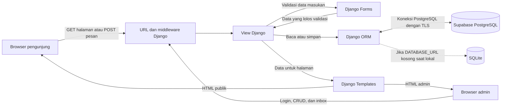
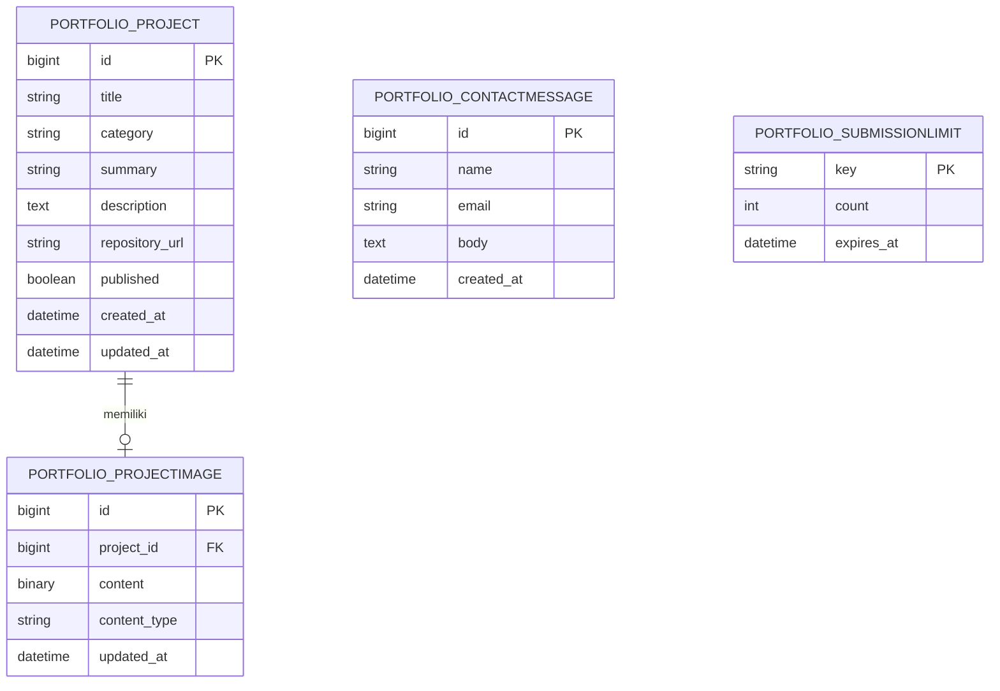
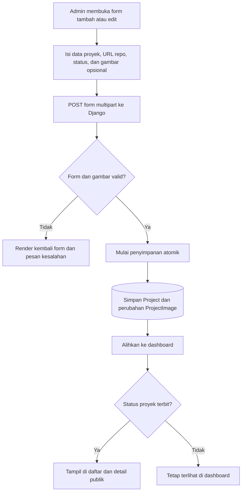
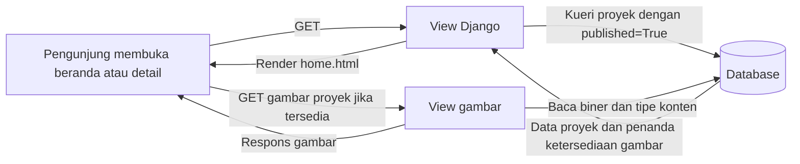
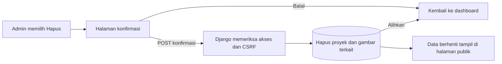
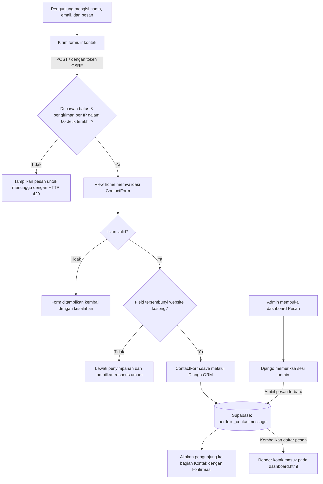

# Dokumentasi Portofolio 'Athif

Portofolio Athif adalah situs Django untuk menampilkan profil, catatan studi, dan proyek. Pengunjung bisa mengirim pesan dari halaman publik. Admin mengelola proyek dan membaca pesan melalui dashboard terpisah.

Dokumen ini mencakup perencanaan, arsitektur, alur data, implementasi, pengujian, dan persiapan deploy. Panduan menjalankan proyek tersedia di [README](../README.md). Lihat juga [hasil dan cara pengujian](testing.md).

## 1. Perencanaan

### Tujuan dan hasil yang diharapkan

- Pengunjung dapat melihat profil, catatan studi, dan proyek yang sudah terbit.
- Pengunjung dapat membuka detail proyek dan mengikuti tautan repositori jika tersedia.
- Admin dapat masuk ke dashboard, membuat proyek, mengeditnya, mengatur publikasi, dan menghapusnya.
- Admin dapat memilih gambar proyek dari perangkat dan melihat pratinjau sebelum menyimpan.
- Pesan valid dari formulir publik tersimpan di database yang dipakai aplikasi dan dapat dibaca admin.
- Tampilan tetap dapat digunakan di desktop, tablet, dan HP. Pada layar kecil navigasi memakai menu hamburger.

### Peran pengguna

| Peran      | Akses                                                                            |
| ---------- | -------------------------------------------------------------------------------- |
| Pengunjung | Beranda, detail dan gambar proyek terbit, serta formulir kontak                  |
| Admin      | Login, dashboard, proyek terbit dan draf, unggah gambar, kotak masuk, dan logout |

### Tahap pengerjaan

| Tahap               | Hasil                                                                                                                               |
| ------------------- | ----------------------------------------------------------------------------------------------------------------------------------- |
| Analisis kebutuhan  | Bagian publik, akses admin, CRUD proyek, unggahan, dan pengiriman pesan ditentukan.                                                 |
| Rancangan antarmuka | Beranda, login, dan dashboard disusun sebagai tiga template. Antarmuka publik memakai tema ungu dan ilustrasi Okayu.                |
| Rancangan data      | Proyek, gambar, pesan, dan slot pembatas pengiriman disimpan pada model terpisah.                                                   |
| Implementasi        | URL, view, formulir, autentikasi admin, publikasi, dan kotak masuk dihubungkan.                                                     |
| Integrasi database  | SQLite disediakan untuk pengembangan lokal. PostgreSQL Supabase dipilih melalui `DATABASE_URL`.                                     |
| Pengujian           | Migrasi, akses publik dan admin, operasi proyek, gambar, dan pesan diperiksa dengan database lokal.                                 |
| Rilis               | Variabel lingkungan dan migrasi produksi disiapkan, lalu aplikasi dapat dideploy manual ke Vercel dan diuji lewat URL hasil deploy. |

## 2. Teknologi dan struktur

| Komponen                  | Tanggung jawab                                                                      |
| ------------------------- | ----------------------------------------------------------------------------------- |
| HTML dan Django Templates | Menyusun halaman publik, login, dan dashboard dari data yang diberikan view.        |
| CSS                       | Mengatur tema, tata letak, fokus, dan responsivitas antarmuka.                      |
| JavaScript                | Membuka dan menutup menu HP serta membuat pratinjau lokal untuk unggahan gambar.    |
| Django 5.2                | Menangani URL, validasi, autentikasi, sesi, logika aplikasi, dan rendering halaman. |
| Django ORM dan psycopg    | Menghubungkan model dengan PostgreSQL saat memakai Supabase.                        |
| Pillow                    | Memeriksa isi, format, dan dimensi gambar unggahan.                                 |
| SQLite                    | Database lokal ketika `DATABASE_URL` kosong.                                        |
| Supabase PostgreSQL       | Database yang menyimpan data produksi ketika `DATABASE_URL` diarahkan ke Supabase.  |
| Vercel                    | hosting untuk aplikasi Django dan aset statis.                                      |

```text
config/
├── settings.py             Pengaturan aplikasi, database, dan aset statis
├── urls.py                 Daftar URL
└── wsgi.py                 Titik masuk server WSGI
portfolio/
├── forms.py                Form login, kontak, dan proyek
├── models.py               Struktur data proyek, gambar, dan pesan
├── views.py                Alur permintaan dan respons
├── rate_limits.py          Pembatas login dan pengiriman kontak
├── tests.py                Uji regresi batas permintaan
└── migrations/             Riwayat perubahan struktur database
templates/
├── home.html               Beranda dan detail proyek
├── login.html              Login admin
└── dashboard.html          Daftar proyek, editor, hapus, dan kotak masuk
static/portfolio/
├── css/style.css           Gaya antarmuka dan layout responsif
├── js/site.js              Menu HP dan pratinjau gambar
└── images/                 Logo dan ilustrasi yang dipakai situs
docs/
├── dokumentasi.md          Dokumentasi proyek
└── testing.md              Hasil dan panduan uji
```

## 3. Arsitektur dan aliran data

Browser mengirim permintaan HTTP ke Django. Django membaca atau menulis database lewat ORM, lalu merender HTML dengan data yang relevan. Kredensial database hanya dipakai di server. Saat produksi memakai Supabase, browser tetap berkomunikasi dengan Django dan Django yang membuka koneksi PostgreSQL.



### Model data

| Model                    | Tabel                         | Data utama                                                                                              |
| ------------------------ | ----------------------------- | ------------------------------------------------------------------------------------------------------- |
| `Project`                | `portfolio_project`           | Judul, kategori, ringkasan, deskripsi, URL repositori opsional, status publikasi, dan waktu pencatatan. |
| `ProjectImage`           | `portfolio_projectimage`      | Relasi ke proyek, isi file biner, tipe konten, dan waktu pembaruan.                                     |
| `ContactMessage`         | `portfolio_contactmessage`    | Nama, email, isi pesan, dan waktu kirim.                                                                |
| `SubmissionLimit`        | `portfolio_submissionlimit`   | Kunci hash per IP, jenis permintaan, dan slot, serta waktu setiap slot tersedia kembali.                |
| Pengguna dan sesi Django | `auth_user`, `django_session` | Akun admin dan sesi login.                                                                              |



Satu proyek dapat memiliki satu gambar. Menghapus proyek ikut menghapus gambarnya melalui relasi cascade. Pesan kontak berdiri sendiri dan tidak membutuhkan akun pengunjung. Kolom `link` lama masih ada pada model untuk menyimpan data lama. Form admin dan UI publik saat ini memakai `repository_url` sebagai satu-satunya tautan eksternal proyek.

## 4. Rute dan akses

| Metode    | Rute                        | Akses dan fungsi                                               |
| --------- | --------------------------- | -------------------------------------------------------------- |
| GET       | `/`                         | Beranda dan daftar proyek terbit, delapan proyek per halaman.  |
| POST      | `/`                         | Menerima formulir kontak publik.                               |
| GET       | `/proyek/<id>/`             | Detail proyek terbit.                                          |
| GET       | `/proyek/<id>/gambar/`      | Gambar proyek, mengikuti visibilitas proyek untuk pengunjung.  |
| GET, POST | `/admin/login/`             | Menampilkan form dan memeriksa kredensial admin.               |
| POST      | `/admin/logout/`            | Mengakhiri sesi dan kembali ke login.                          |
| GET       | `/admin/`                   | Menampilkan proyek terbit dan draf kepada admin.               |
| GET, POST | `/admin/proyek/baru/`       | Menampilkan form dan membuat proyek.                           |
| GET, POST | `/admin/proyek/<id>/edit/`  | Menampilkan proyek yang ada dan menyimpan perubahan.           |
| GET, POST | `/admin/proyek/<id>/hapus/` | Menampilkan konfirmasi dan menghapus proyek saat dikonfirmasi. |
| GET       | `/admin/pesan/`             | Menampilkan pesan kontak kepada admin, terbaru lebih dulu.     |

Form login memakai autentikasi Django dan menerima akun admin aktif dengan status `is_superuser`. Gunakan `createsuperuser` untuk membuat akun admin baru. Pengunjung yang membuka URL dashboard tanpa sesi admin dialihkan ke halaman login. Form yang mengubah data memakai CSRF. Logout dan penghapusan dilakukan melalui POST. Login dibatasi lima percobaan gagal per IP dalam 10 menit terakhir. Login berhasil tidak memakai jatah percobaan gagal. Jika batas tercapai, aplikasi mengembalikan HTTP 429 dan durasi tunggu melalui header `Retry-After`.

## 5. Alur CRUD proyek

| Operasi    | Dari antarmuka ke database                                                                      | Hasil yang terlihat                                                                   |
| ---------- | ----------------------------------------------------------------------------------------------- | ------------------------------------------------------------------------------------- |
| **Create** | Admin mengirim form tambah. Django memvalidasi data dan menyimpan proyek serta gambar jika ada. | Proyek muncul di dashboard. Jika statusnya terbit, proyek muncul di halaman publik.   |
| **Read**   | View mengambil daftar atau detail dari database. View publik menyaring `published=True`.        | Dashboard menampilkan draf dan proyek terbit. Halaman publik menampilkan yang terbit. |
| **Update** | Admin mengirim form edit. Django menyimpan perubahan dan dapat mengganti atau menghapus gambar. | Dashboard menampilkan data baru. Halaman publik ikut berubah jika proyek terbit.      |
| **Delete** | Admin mengonfirmasi lewat form. Django menghapus proyek dan gambar yang terhubung.              | Proyek hilang dari dashboard dan daftar publik. URL detail lama mengembalikan 404.    |

### Tambah dan edit proyek



Data proyek dan perubahan gambarnya disimpan dalam satu transaksi. Gambar diproses oleh Pillow dan dibatasi pada JPG, PNG, atau WebP hingga 2 MB dan 16 megapiksel. Saat edit, admin dapat mempertahankan, mengganti, atau menghapus gambar. Pratinjau JavaScript berasal dari file yang baru dipilih di browser, sedangkan penyimpanan terjadi saat form berhasil dikirim.

### Dari database kembali ke halaman proyek



### Hapus proyek



## 6. Alur pesan dari web publik ke Supabase

Jika `DATABASE_URL` berisi alamat database Supabase dan migrasi sudah dijalankan pada skema tujuan, **pesan valid yang dikirim pengunjung masuk ke tabel `portfolio_contactmessage` di Supabase PostgreSQL**. Dari database itu, Django mengambil pesan untuk ditampilkan di **Dashboard → Pesan**. Jika `DATABASE_URL` kosong saat pengembangan lokal, proses yang sama memakai SQLite.



Setiap pengiriman formulir menempati satu dari delapan slot untuk IP tersebut selama 60 detik. Pergantian menit pada jam tidak mereset slot dan permintaan yang ditolak tidak menambah waktu tunggu. Pesan menyimpan nama pengirim, alamat email, isi pesan, dan waktu kirim. Kolom tersembunyi `website` berfungsi sebagai honeypot. Pengiriman biasa menggunakan formulir HTML dan tidak membutuhkan JavaScript. Notifikasi keberhasilan tampil di halaman, sedangkan pesan yang tersimpan dibaca melalui dashboard.

## 7. Konfigurasi dan migrasi

1. Buat virtual environment, pasang dependensi, dan siapkan `.env` berdasarkan [.env.example](../.env.example). Proyek membaca `.env` otomatis.
2. Untuk Supabase, isi `DATABASE_URL` dengan URL **Session pooler**. Isi `DJANGO_DB_SCHEMA` sesuai skema yang dipakai. Nilai bawaan di kode adalah `public`. Jika memakai skema khusus untuk instalasi baru, buat skema tersebut sebelum migrasi.
3. Pastikan database dan skema yang dipilih benar sebelum menjalankan perintah di bawah. Migrasi awal membuat tabel aplikasi. Migrasi kedua menambah kolom `repository_url`. Migrasi ketiga membuat tabel pembatas pengiriman dan mencabut grant langsung untuk role publik Data API pada tabel aplikasi dan autentikasi Django di PostgreSQL. Jalankan migrasi PostgreSQL melalui role pemilik tabel.
4. Buat akun admin sekali pada database yang dipakai. Jika akun sudah tersedia, lanjut masuk dengan akun tersebut.

```sh
python manage.py migrate
python manage.py createsuperuser
python manage.py check
```

Variabel produksi dan langkah konfigurasi lanjutan ada di [README](../README.md#konfigurasi-lingkungan). File `.env` yang berisi kredensial diabaikan oleh Git.

## 8. Pengujian

[Dokumentasi pengujian](testing.md) memuat perintah uji otomatis, hasil pemeriksaan lokal, langkah pengecekan di browser, dan cara memastikan pesan dari situs publik masuk ke Supabase. Uji regresi di `portfolio/tests.py` mencakup batas login dan formulir kontak, pesan peringatan login, serta waktu tunggu melalui `Retry-After`.

## 9. Rilis dan pemeliharaan

1. Terapkan migrasi pada database Supabase yang dituju dan pastikan akun admin sudah tersedia.
2. Impor repositori ke Vercel dan isi variabel lingkungan produksi dari dashboard. Gunakan `DJANGO_DEBUG=0`, kunci Django unik, serta `DATABASE_URL` untuk Supabase.
3. Deploy aplikasi Django dari direktori yang berisi `manage.py`. Verifikasi aset statis di halaman hasil deploy.
4. Uji login, publikasi proyek, tampilan gambar, dan pengiriman pesan dari URL produksi. Cocokkan pesan uji yang masuk di Supabase dengan tampilan dashboard.
5. Untuk pembaruan berikutnya, perbarui konten proyek dari dashboard. Jika model berubah, buat migrasi, uji secara lokal, lalu terapkan migrasi ke database tujuan sebelum merilis kode baru.

Panduan setup dan [langkah deploy manual](../README.md#deploy-manual-ke-vercel) tersedia di README. Tahap rilis selesai setelah alur publik dan admin berhasil diuji pada URL hasil deploy dengan database Supabase yang dipilih.
